# Лабораторная работа по FastAPI

**Выполнила:** Россихина А. Д.  
**Группа:** КБ-241

## Описание проекта
Веб-приложение на базе фреймворка FastAPI с использованием менеджера пакетов `uv`, валидацией данных через Pydantic, модульной структурой роутеров (`APIRouter`), конфигурацией из `.env` через `pydantic-settings` и логированием.

---

## Ход выполнения работы

### 1. Инициализация проекта и базовый маршрут
Создано виртуальное окружение с помощью `uv`, установлены пакеты `fastapi` и `uvicorn`, настроен `.gitignore` и реализован корневой эндпоинт `GET /`.

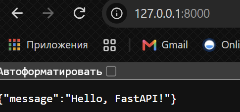

### 2. Эндпоинт с параметрами пути и query-параметрами
Реализован маршрут `GET /items/{item_id}` с автоматической валидацией типов параметров пути и строки запроса.

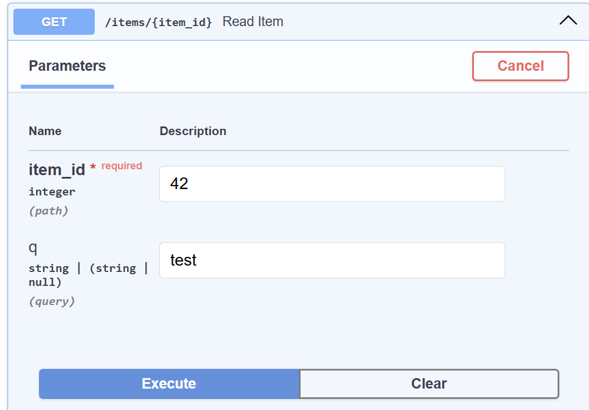
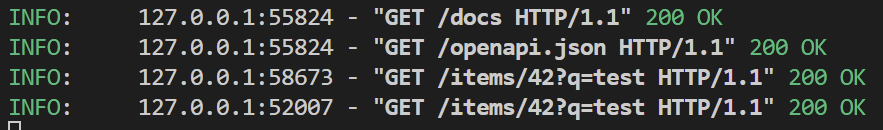

### 3. Модель Pydantic и обработка POST-запроса
Описана схема данных `Item` на базе `BaseModel` и создан эндпоинт `POST /items/` для приёма и возврата JSON-объектов.

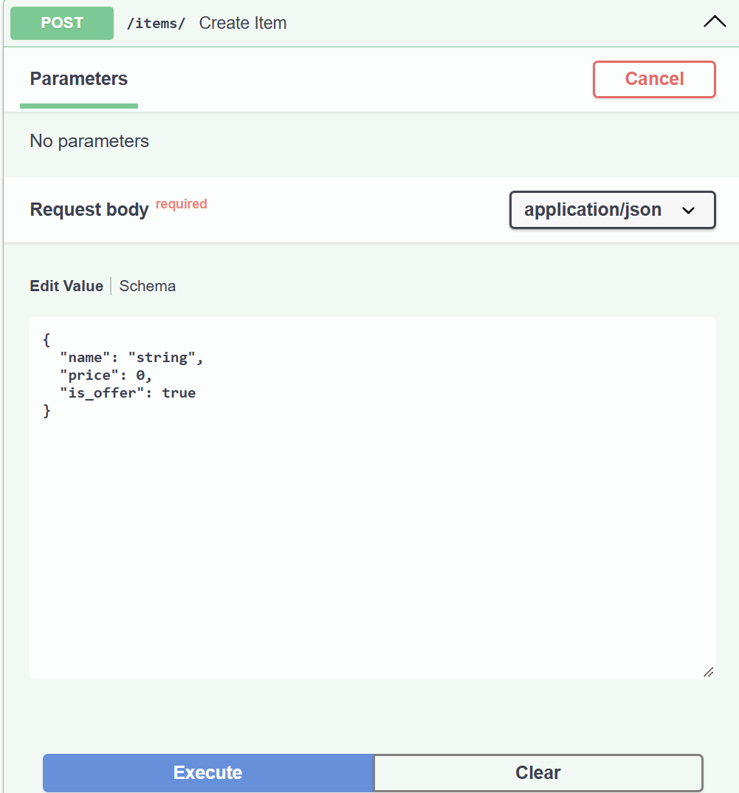
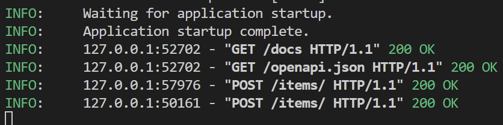

### 4. Рефакторинг и вынос маршрутов в APIRouter
Логика работы с товарами вынесена в отдельный модуль `app/routers/items.py` с префиксом `/items` и подключена в `main.py`.

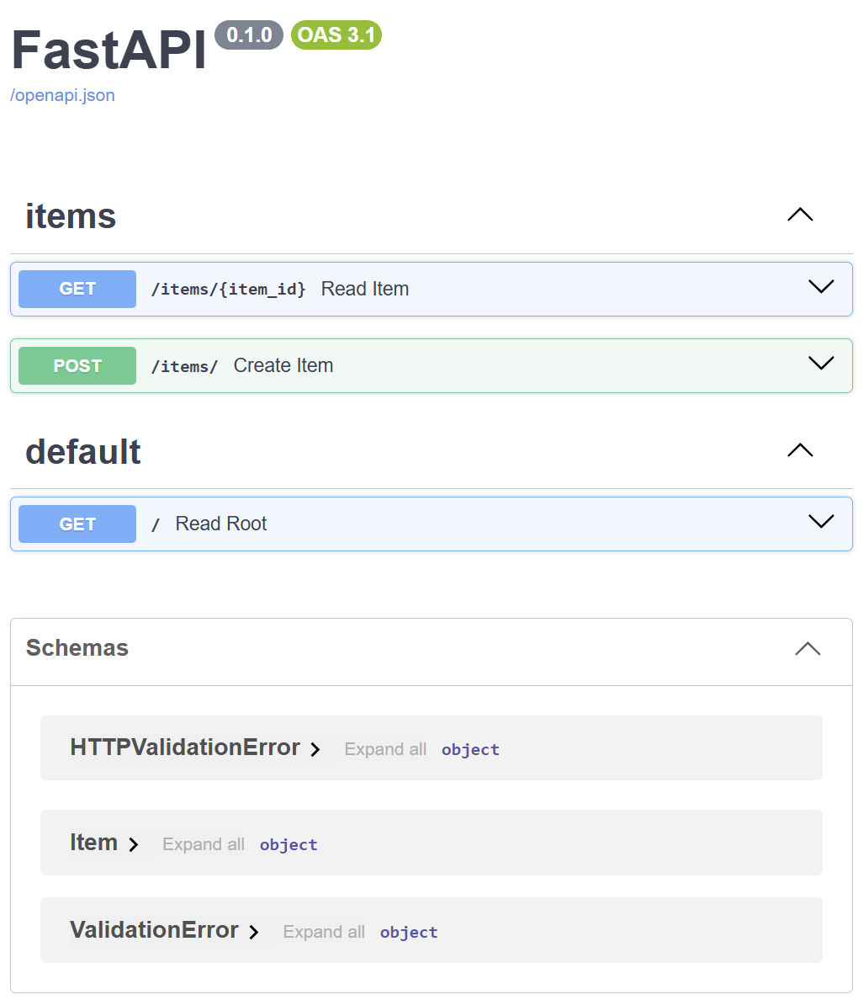

### 5. Конфигурация приложения через Pydantic Settings
Настройки приложения вынесены в класс `Settings` с загрузкой переменных из файла `.env`. Реализован эндпоинт `GET /info`.

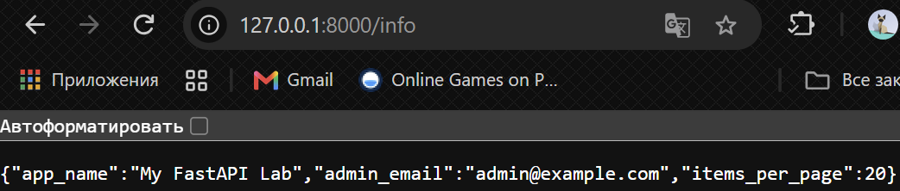

### 6. Обработка ошибок и расширение OpenAPI-документации
Добавлена имитация базы данных, обработка ошибки `404 Not Found` при запросе несуществующего товара, а также метаданные и ограничения параметров (`Path`, `Query`, `Field`).

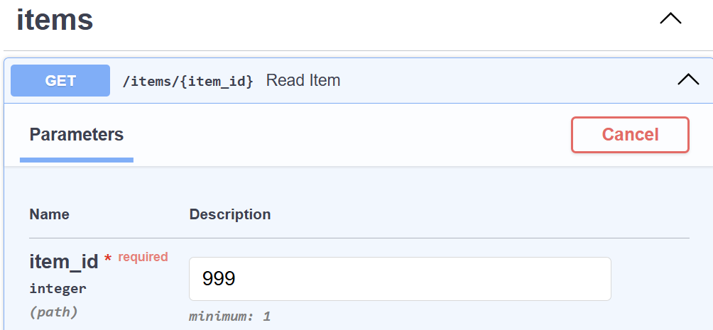
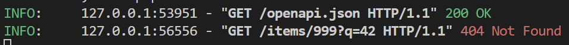

### 7. Самостоятельная работа: обновление товара (PUT) и проверка уникальности
Реализован маршрут `PUT /items/{item_id}` с проверкой существования записи (`404`) и добавлена валидация уникальности названия товара при создании и обновлении (`400 Bad Request` при дубликате).

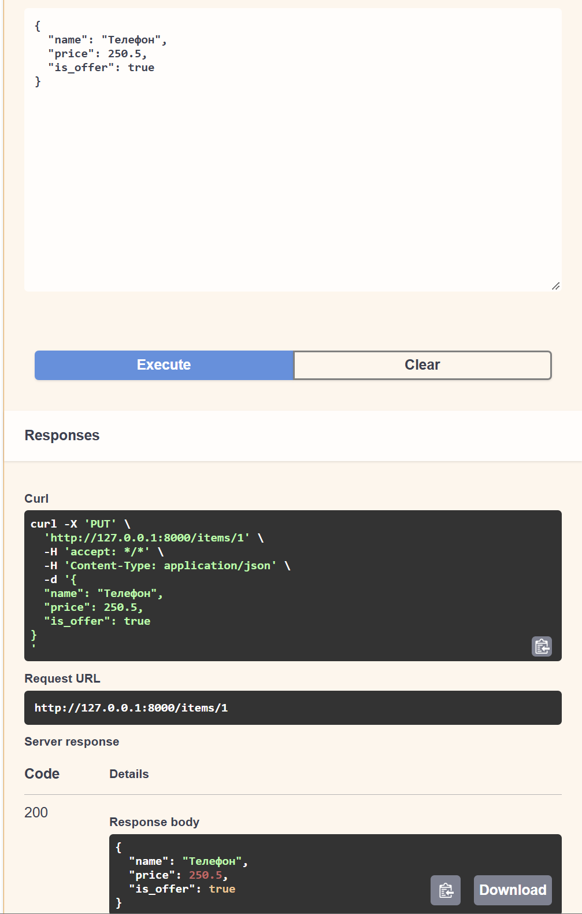
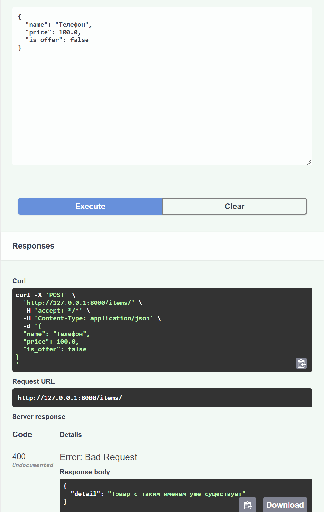

### 8. Самостоятельная работа: логирование
Подключён стандартный модуль `logging` для записи информационных сообщений (`INFO`) и предупреждений (`WARNING`) при обращении к эндпоинтам и возникновении ошибок.

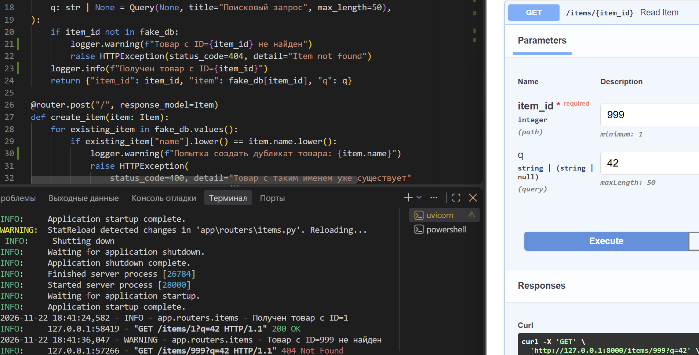
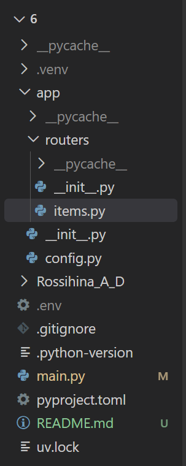

---

## История коммитов
Список выполненных коммитов (`git log --oneline`):

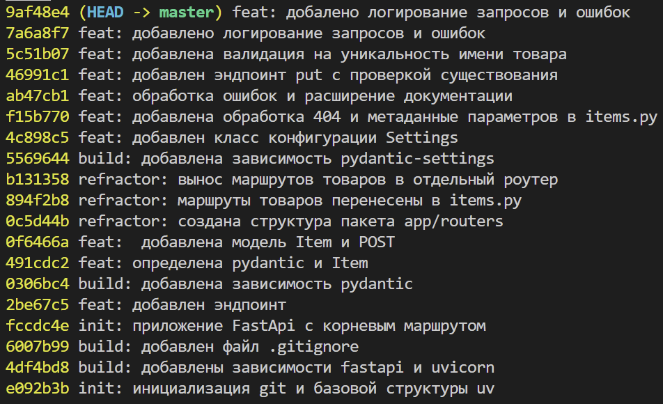
